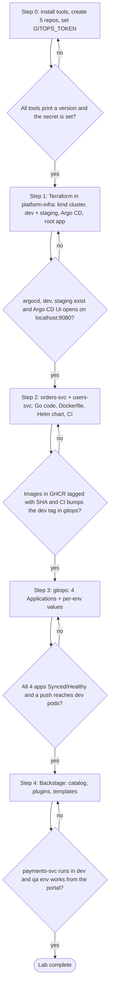
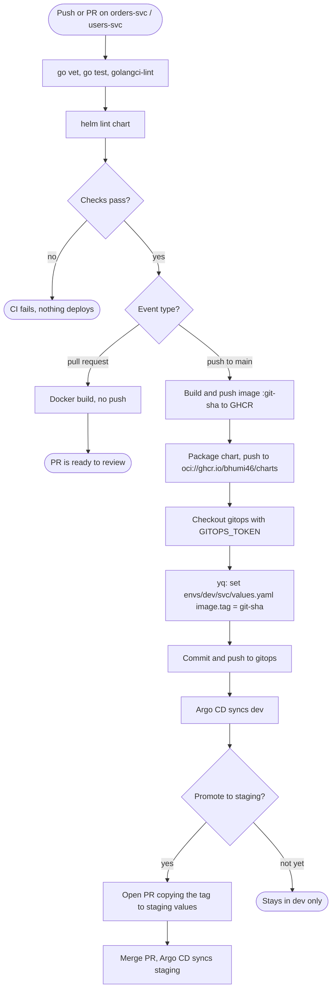
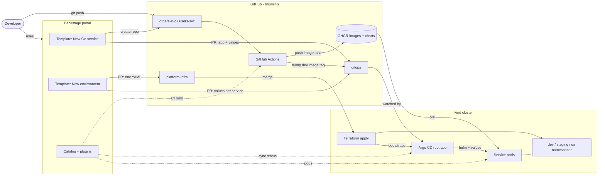
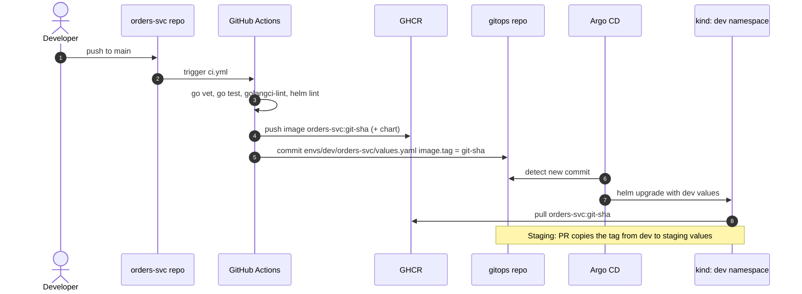
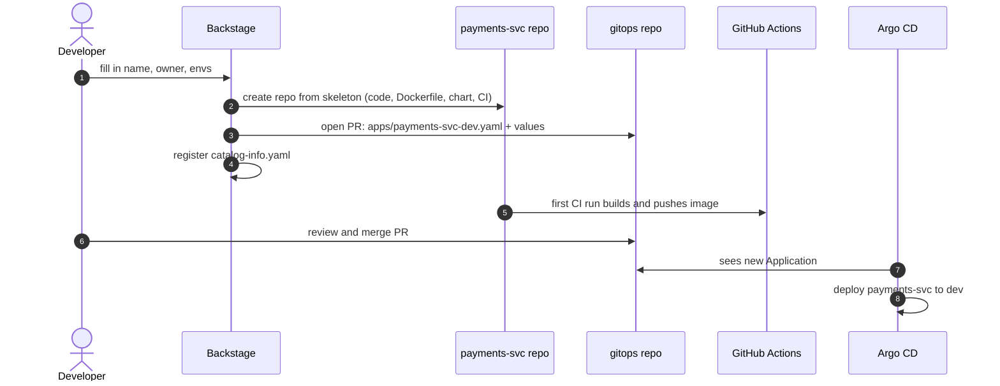
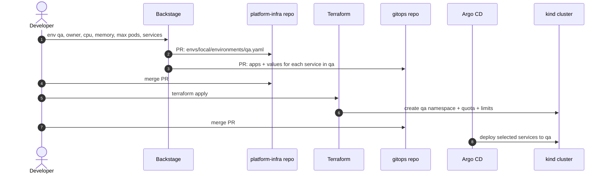

# IDP lab flow diagrams

How a change gets from Backstage to the cluster. See [PLAN.md](../PLAN.md) for the full plan.

## Build order

The order to build the lab in. Each step has to pass its Done when checklist before you start the next one.

## CI pipeline decisions

What ci.yml in each service repo does, depending on the event.

## 1. The whole system

Solid arrows write or deploy. Dotted arrows are Backstage reading status for each service page.

## 2. Code push to running pods

Covers plan steps 2 and 3. Dev deploys automatically; staging is promoted by a PR.

## 3. New Go service from the portal

Plan step 4c. Running the template with `payments-svc` ends with it running in dev.

## 4. New environment from the portal

Plan step 4d. Two PRs: one creates the namespace, the other deploys services into it.

> Backstage never runs Terraform or kubectl. It only creates repos and opens PRs, so every change is reviewed in Git first.
